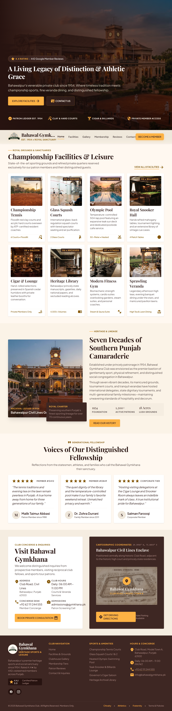
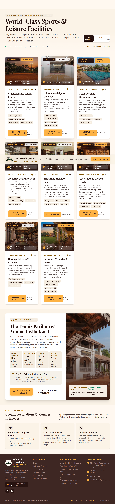

# Bahawal Gymkhana — Website

A Next.js (App Router + TypeScript + Tailwind v4) website for **Bahawal Gymkhana**,
a real members-only heritage sports & social club in Bahawalpur, Pakistan (Google
Maps profile: 4.4★, 442 reviews) that currently has no website of its own.

Design system: "Heritage Athletic" — Espresso (#3E2723) + Mustard (#F2A93B),
Playfair Display + Plus Jakarta Sans. Created in Google Stitch, then hand-converted
into React/Tailwind components.

## Live Preview

https://bahawal-gymkhana.vercel.app/

## Screenshots

### Home
| Desktop | Mobile |
|---|---|
|  
|  |

### Facilities
| Desktop | Mobile |
|---|---|
|  
|  |

### Gallery
| Desktop | Mobile |
|---|---|
|  
|  |

### Membership
| Desktop | Mobile |
|---|---|
|  
|  |

### Reviews
| Desktop | Mobile |
|---|---|
|  
|  |

### Contact
| Desktop | Mobile |
|---|---|
|  
|  |

### History
| Desktop | Mobile |
|---|---|
|  
|  |

### Terms & Policies
| Desktop | Mobile |
|---|---|
|  
|  |

## Pages (routing)
- `/` — Home
- `/facilities` — Tennis, squash, gym, pool, lawn, library, cigar room, snooker
  — with a working **filter tabs** + **booking modal** (pick a facility, pick a
  time, submit — hits the contact API)
- `/gallery` — Photo gallery with working **category filter tabs**, a working
  **lightbox** (click any "Enlarge" button), and a working **archive submission
  modal**
- `/membership` — Membership tiers + inquiry form; "Apply" buttons scroll to the
  form
- `/reviews` — Live search + filter over member reviews, plus a **"Write a Member
  Review" modal** with a working star picker, and a real Google Maps review link
- `/contact` — Full contact form + club info + map, side by side

## API endpoints
- `GET /api/reviews?sort=recent|highest|lowest` — returns rating breakdown + reviews
- `POST /api/contact` — accepts `{ name, email, phone, subject, message }`
  (also used by the facility booking modal and the gallery archive modal)
- `POST /api/membership` — accepts `{ fullName, phone, email, membershipType, proposer, message }`

Both POST routes validate required fields and return `{ success, message }` or
`{ success: false, error }`. In this demo they just log to the server console —
swap in a database or email service (e.g. Resend, Nodemailer) for production.

## Running locally
```bash
npm install
npm run dev
```
Open http://localhost:3000

## Notes

- Google Fonts (Playfair Display, Plus Jakarta Sans, Material Symbols) load via
  `<link>` tags in `app/layout.tsx` — no build-time fetch required, works out of
  the box on Vercel.
- Colors, spacing, and typography are defined as a Tailwind v4 `@theme` in
  `app/globals.css`.
- Layout is desktop-first responsive: content is capped at 1280px and grids
  reflow from 1 column (mobile) up to 3–4 columns (desktop).
